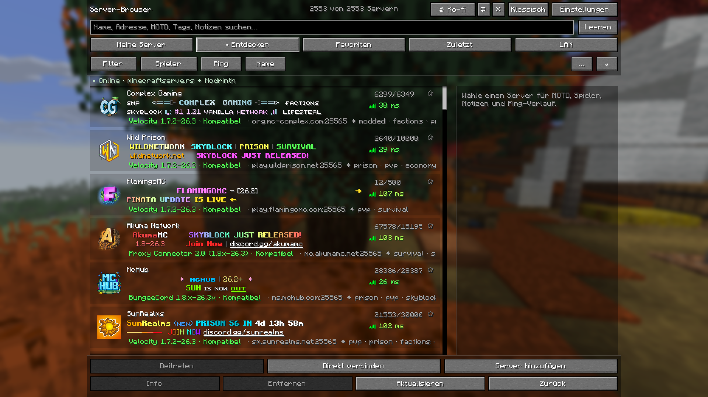
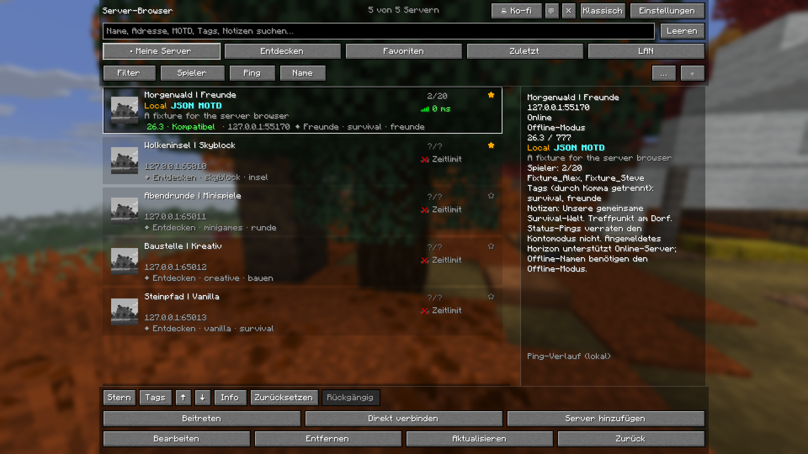

# Server Atlas

Fabric und Forge sind als öffentliche Beta 2.2.0 für Minecraft 26.3 / Java 25 verfügbar. Jeweils die passende JAR in den mods-Ordner legen: [Fabric](downloads/server-browser-fabric-2.2.0+mc26.3.jar) · [Forge](downloads/server-browser-forge-2.2.0+mc26.3.jar). Fabric Loader ab 0.20.1 bzw. Forge ab 66.1.5. Die Horizon-Version 2.1.0 bleibt separat verfügbar. [Anleitung und Prüfgrenzen](java/README.md).

[Projekt auf Ko-fi unterstützen](https://ko-fi.com/foryou41) ·
[Deutsche Website](https://musti3214.github.io/Horizon-Server-Browser/de/) ·
[English website](https://musti3214.github.io/Horizon-Server-Browser/)

**Weniger suchen. Die nächste gemeinsame Welt finden.**

Native Rust-Mod für Horizon mit vertrauter Minecraft-Oberfläche, öffentlichem
Serververzeichnis, Filtern und einer persönlichen Serverliste. Entwickelt für shuab.

[Website und Galerie](https://musti3214.github.io/Horizon-Server-Browser/) ·
[Version 2.1 herunterladen](https://musti3214.github.io/Horizon-Server-Browser/download/) ·
[English](README.md)

## Funktionen

- Öffentliche Java-Server von **minecraftserve.rs und Modrinth** entdecken.
- **2.835 eindeutige Serveradressen** im eingebetteten Katalog, Stand 03.11.2026.
- Namen, Adressen, MOTD, Tags und Notizen durchsuchen.
- Nach Status, Version, Spielern, Ping, Sprache, Region und Gruppe filtern.
- Favoriten, Gruppen, Notizen und eigene Filterprofile lokal verwalten.
- Echte Minecraft-Schaltflächen, transparente Liste und klassische Ansicht.

## Installieren

1. `server-browser-2.1.0.hnmod` herunterladen und eine eigene Horizon-Instanz wählen.
2. Datei in den zugehörigen Ordner `horizon-native-mods` legen.
3. In der Mods-Seite **server_browser 2.1.0 einschalten**, **Bauen** wählen und die
   Vertrauensentscheidung für nativen Code selbst bestätigen.
4. Nach Abschluss die gebaute Instanz starten und **Mehrspieler** öffnen.

Bei einem Mod-Update ist ein neuer nativer Build nötig. Ein alter 2.0-Client lädt
die 2.1-Datei nicht während des Betriebs nach. Unterschiedliche native Mods können
verschiedene Horizon-Quellstände benötigen. [Anleitung](docs/INSTALLATION.md).

## Stand

Horizon 2.1.0 für Minecraft Java 26.3 ist verfügbar und unter Windows x64 getestet.
Fabric und Forge 2.2.0 sind als öffentliche Beta-JARs für Minecraft 26.3 / Java 25 verfügbar. [Java-Anleitung und Prüfbericht](java/README.md).
Feedback- und Servervorschlagsentwürfe bleiben lokal; automatischer Mailversand
ist noch nicht konfiguriert. [Datenschutz](docs/PRIVACY.md).

Alle Bilder sind unveränderte Aufnahmen der gebauten Mod. Eigene Server und
Notizen sind Beispieldaten; die Entdecken-Aufnahme zeigt einen echten Online-Test.
44 Rust-Tests, strenges Library-Clippy sowie isolierte Spieltests bestanden.
[Prüfbericht](docs/VALIDATION.md) · [Quellen](docs/SERVER-SOURCES.md) · [MIT-Lizenz](LICENSE).
