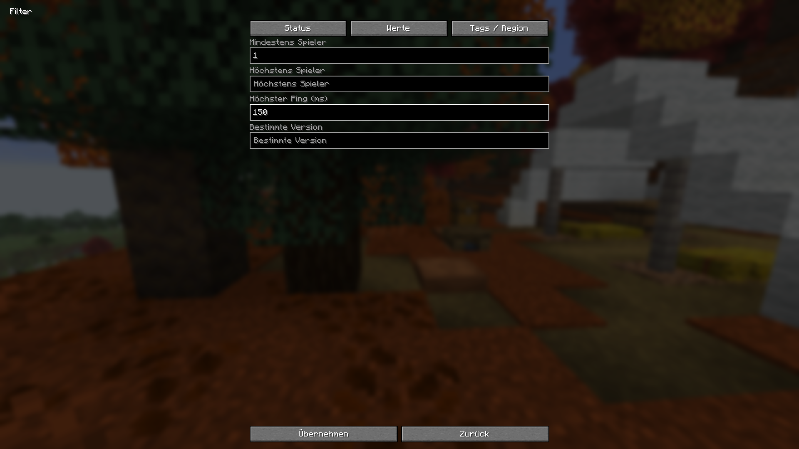
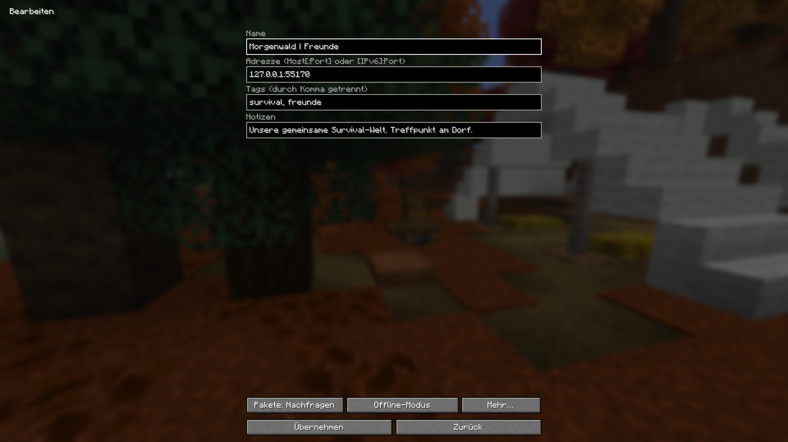
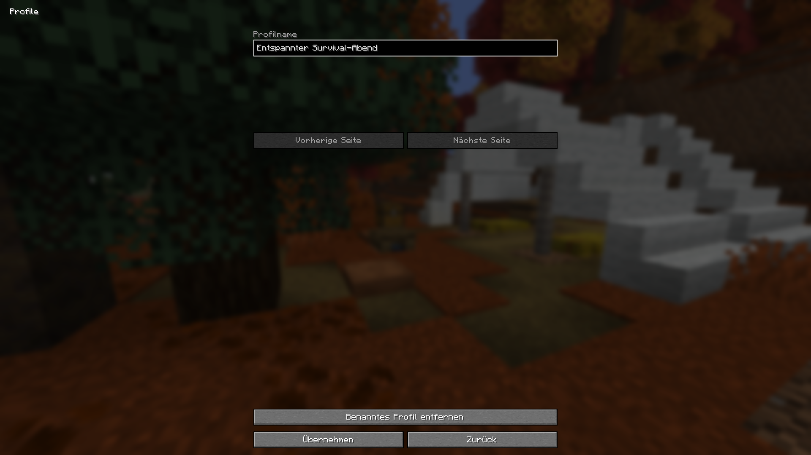
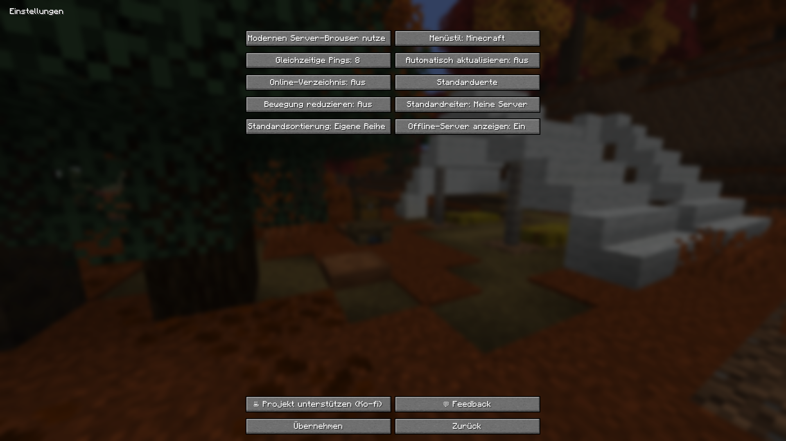

# Minecraft Server Browser

**Find your next Minecraft server. Keep your favorite worlds close.**

A native Rust mod for Horizon with a familiar Minecraft interface, public server
discovery, practical filters and a personal server list. Built by shuab.

[Website & screenshots](https://musti3214.github.io/Horizon-Server-Browser/) ·
[Download 2.1.0](https://musti3214.github.io/Horizon-Server-Browser/downloads/server-browser-2.1.0.hnmod) ·
[Installation](docs/INSTALLATION.md) · [Deutsch](README.de.md)

Website languages: [English](https://musti3214.github.io/Horizon-Server-Browser/),
[Deutsch](https://musti3214.github.io/Horizon-Server-Browser/de/),
[Français](https://musti3214.github.io/Horizon-Server-Browser/fr/),
[Español](https://musti3214.github.io/Horizon-Server-Browser/es/).
If you would like to support development: [Support this project on Ko-fi](https://ko-fi.com/foryou41).


*An unedited capture of the built mod. Server status and player counts are momentary values.*

## One browser. Your next adventure.

- **Discover public Java servers** from minecraftserve.rs and Modrinth.
  The bundled catalog contains **2,835 unique addresses**, researched on November 3, 2026.
- **Search and filter** names, addresses, MOTDs, tags and personal notes. Combine
  status, version, player count, ping, language, region and group filters.
- **Keep your own list** with favorites, notes, groups, custom ordering and reusable
  filter profiles. Personal data stays in the local game profile.
- **Feel at home** with actual Minecraft buttons, resource-pack support, translucent
  rows and a centered layout. Classic mode remains available.
- **Stay in control** with cached public directories, bounded status checks and
  persistent discovery preferences. An explicit Off remains Off.

## Available now

| Platform | Status | Download |
| --- | --- | --- |
| Horizon, Minecraft Java 26.3 | **2.1.0 · native Rust mod**; tested on Windows x64 | `.hnmod` |
| Fabric | Planned | No release yet |
| Forge | Planned | No release yet |

The Horizon package uses the official native-mod build process. It includes its
Rust sources and requires no companion program or separately installed host patch.
It is pinned to the exact Horizon commit documented in [validation](docs/VALIDATION.md).

## A closer look

### Your servers, your details


### Filter the way you play



<details>
<summary><strong>More real screenshots: editing, profiles and settings</strong></summary>







</details>

Function screenshots use disposable example profiles and local status fixtures.
The discovery image comes from a real public-directory test. No private player
worlds, accounts or personal server lists appear in these images.

## Install in Horizon

1. Download `server-browser-2.1.0.hnmod` and select a dedicated Horizon instance.
2. Put the file in that instance's `horizon-native-mods` folder.
3. On the launcher's Mods page, enable **server_browser 2.1.0**. Choose **Build**
   for the package's tested revision and review the native-code trust notice.
4. After the build finishes, launch that instance and open **Multiplayer**.

An existing 2.0 client cannot hot-load the 2.1 source update. Rebuild after changing
the package. Other native mods may target different Horizon commits; test this
mod on its own first. [Full instructions and troubleshooting](docs/INSTALLATION.md).

## Privacy and current limits

Your saved servers, favorites and notes stay local. Public-directory requests go
only to the named sources; normal status pings contact the servers being checked.
The mod uses Horizon's existing login and connection implementation.

Feedback and server-proposal drafts can be saved locally. **Automatic email
delivery is not configured in 2.1.0.** Fabric and Forge are planned ports.
The web catalog is a dated address list and does not claim live player counts.
Read [privacy](docs/PRIVACY.md) and [server sources](docs/SERVER-SOURCES.md).

## Development

`mod/` contains the original Rust implementation, translations, native manifest
and official-mixin helpers. `website/` contains the static website and all 13 real
screenshots. `downloads/` contains the tested package and SHA-256 checksum.

```sh
python tools/validate_public.py
python website/build_site.py
python website/tools/validate_site.py
```

Rebuilding the native bundle additionally requires Rust 1.99.1's `rustfmt` on PATH:
`python mod/build_bundle.py`. Running native game tests requires a separately
built pinned Horizon client and your own prepared Minecraft resources.

The release passed **44 Rust tests**, strict library Clippy, native client build
and actual isolated game/UI/directory tests. [Exact scope and inputs](docs/VALIDATION.md).

MIT licensed. Independent community project; not affiliated with or endorsed by
Mojang, Microsoft or the Minecraft modloader projects. [License](LICENSE) · [Notices](NOTICE.md).
