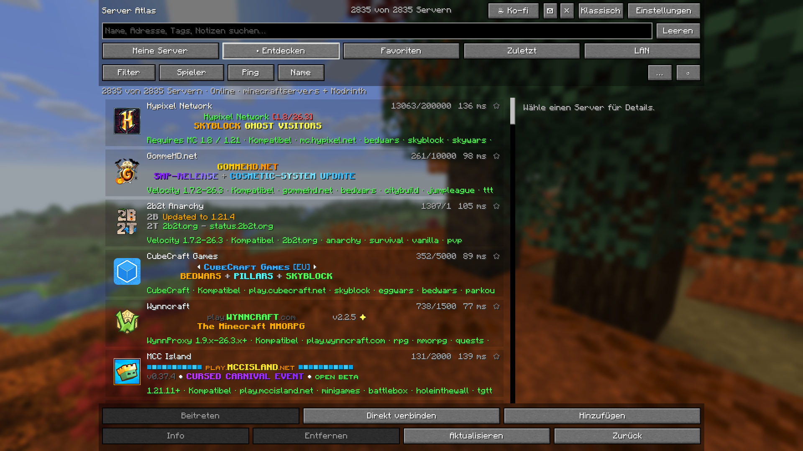
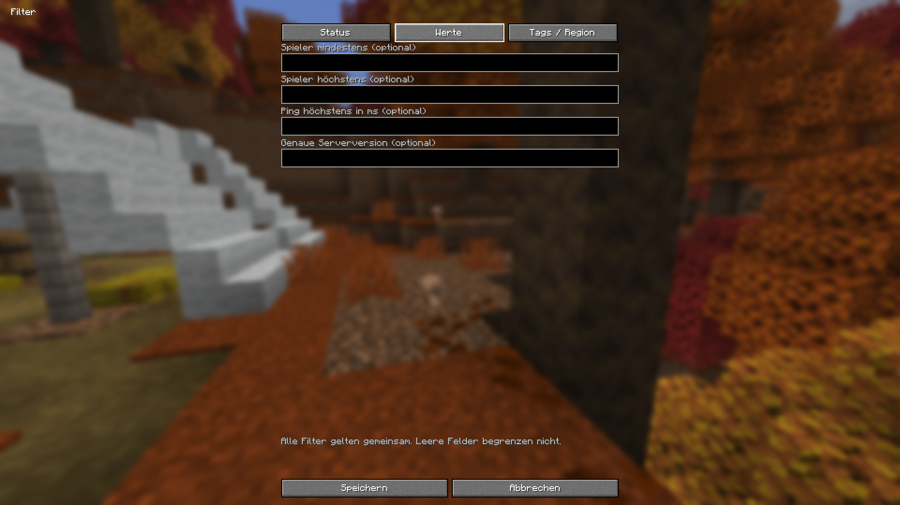

# Server Atlas

Discover Minecraft Java servers without leaving the game. Server Atlas brings a familiar Minecraft-style browser with translucent server rows, public discovery, filters, favorites and local notes.

## Features
- My Servers, Discover, Favorites, Recent and LAN.
- Search names, addresses, MOTDs, tags, groups and notes; combine version, status, player-count, ping, language and region filters.
- 2,835 bundled public server addresses, with cached pages from Modrinth and minecraftserve.rs.
- Real server ping, player counts, colored MOTDs, icons and a local ping history.
- Native Minecraft widgets, reusable filter profiles, custom ordering, add/edit/delete/undo and JSON/NBT import/export.
- English and German, following Minecraft's language setting.

## Installation
Minecraft **26.3** and **Java 25** are required. Install **Fabric Loader 0.20.1+** or **Minecraft Forge 66.1.5+**, place the matching JAR in that instance's `mods` folder, and open **Multiplayer**. Install only the JAR for your loader. Required Fabric API modules are bundled. This is a client-only mod; servers need no installation. Classic returns to the original server screen.

## Public beta
The Java 2.2.0 editions are public betas. Each loader build passes 96 integration checks. The final Fabric JAR was tested in an isolated standard profile with only this mod; the Forge interface was tested in its development client. Paid-account gameplay, every third-party mod combination and a full dedicated-server gameplay test are not claimed.

## Privacy
Your saved servers, favorites and notes stay local. Directory requests do not contain your personal addresses, notes or search text. Visible servers receive standard status requests directly. Each public directory has a persistent one-request-per-minute limit, a five-minute cache and stale-cache fallback. Online discovery can be disabled. Feedback/server suggestions currently save a **local draft only**; automatic email is not configured.

## Links
[Website](https://musti3214.github.io/Horizon-Server-Browser/) · [Source](https://github.com/Musti3214/Horizon-Server-Browser/tree/main/java) · [Issues](https://github.com/Musti3214/Horizon-Server-Browser/issues) · [Support development](https://ko-fi.com/foryou41)

MIT licensed. Independent community project; not an official Minecraft product. The original Horizon Rust edition is a separate .hnmod download. The compass logo is AI-generated original artwork; the product screenshots are unedited captures from the game.
